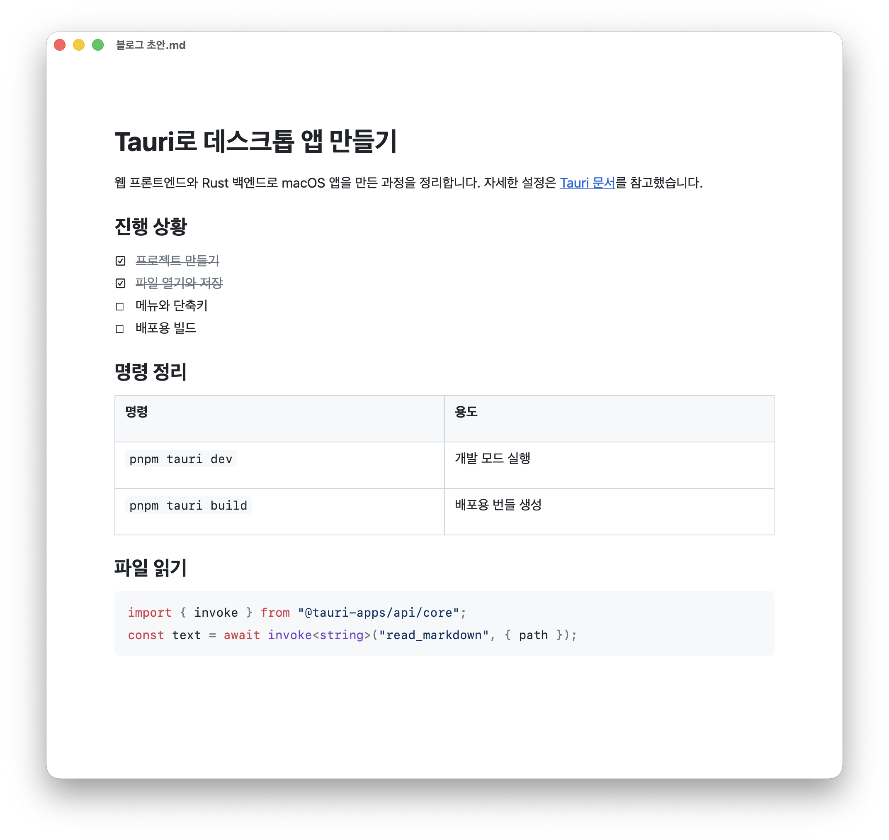

<p align="center">
  
</p>

# Mini Mark

Mini Mark는 마크다운 문서를 서식이 적용된 화면에서 바로 편집하는 macOS 앱입니다. 편집한 내용은 일반 `.md` 파일로 저장합니다.

<picture>
  <source media="(prefers-color-scheme: dark)" srcset="docs/images/screenshot-dark.png">
  
</picture>

화면은 macOS 기본 웹뷰(WKWebView)로 그리며, Chromium은 포함하지 않습니다. 설치 파일(`.dmg`)은 약 6MB이고, 빈 문서를 열어 둔 상태의 메모리 사용량은 약 63MB입니다(Apple Silicon에서 측정).

## 기능

### 편집

- `# `, `- `, `> `처럼 마크다운 문법을 입력하면 그 자리에서 제목, 목록, 인용으로 바뀝니다.
- GFM 표, 작업 목록, 취소선, 각주를 지원합니다. 작업 목록은 체크박스를 클릭하거나 항목에서 `Cmd+Enter`를 눌러 체크할 수 있습니다.
- 코드 블록에는 구문 강조가 적용됩니다(Prism).
- 시스템의 라이트 모드와 다크 모드를 따릅니다.

### 이미지

- 이미지를 붙여넣거나 창에 끌어다 놓으면 문서가 있는 폴더의 `assets/`에 파일로 저장하고, 본문에는 상대 경로로 넣습니다.
- 문서를 다른 폴더에 저장하면 이미지와 링크의 상대 경로를 새 위치에 맞게 고칩니다.

### 복사와 붙여넣기

- Mini Mark에서 복사한 내용을 VS Code나 터미널에 붙이면 마크다운 원문이 들어갑니다. Notion처럼 서식을 받는 앱에 붙이면 서식이 그대로 유지됩니다.
- VS Code에서 복사한 마크다운을 붙이면 원문 대신 서식이 적용된 모습으로 보여 줍니다.
- 자세한 규칙은 [클립보드 스펙](docs/spec/clipboard.md)에서 확인할 수 있습니다.

### 파일

- 저장할 때는 임시 파일에 먼저 쓴 다음 원본과 교체합니다. 그래서 저장 도중 앱이 멈춰도 원본 파일은 그대로 남습니다.
- 다른 프로그램이 열려 있는 파일을 바꾸면 다시 불러올지 묻습니다.
- 저장하지 않은 변경 사항이 있으면 창을 닫거나, `Cmd+Q`로 종료하거나, 다른 파일을 열기 전에 한 번 더 확인합니다.
- File > Open Recent에서 최근에 연 파일을 다시 열 수 있습니다.
- Finder에서 `.md`, `.markdown` 파일을 Mini Mark로 열 수 있습니다. Dock의 Mini Mark 아이콘에 파일을 끌어다 놓아도 열립니다.

## 설치

macOS 12 이상에서 사용할 수 있습니다. 설치 파일 하나로 Apple Silicon 맥과 Intel 맥 모두에서 실행됩니다.

1. [Releases](https://github.com/jong-k/mini-mark/releases)에서 최신 버전의 `.dmg` 파일을 내려받습니다.
2. `.dmg`를 열고 Mini Mark를 Applications 폴더로 끌어다 놓습니다.
3. 터미널에서 다음 명령을 실행합니다.

   ```bash
   xattr -dr com.apple.quarantine "/Applications/Mini Mark.app"
   ```

3단계가 필요한 이유는 Mini Mark가 아직 Apple 공증을 받지 않았기 때문입니다. macOS는 인터넷에서 내려받은 앱 중 공증되지 않은 앱의 실행을 막습니다. 위 명령은 파일에 붙은 다운로드 표시를 지워서 실행할 수 있게 합니다. 명령 대신, 앱을 한 번 실행한 뒤 시스템 설정 > 개인정보 보호 및 보안 화면 아래쪽에서 Mini Mark 실행을 허용해도 됩니다.

## 단축키

| 단축키        | 동작                     |
| ------------- | ------------------------ |
| `Cmd+N`       | 새 문서                  |
| `Cmd+O`       | 열기                     |
| `Cmd+S`       | 저장                     |
| `Cmd+Shift+S` | 다른 이름으로 저장       |
| `Cmd+Enter`   | 작업 목록 항목 체크 전환 |
| `Cmd+Q`       | 종료                     |

## 알려진 한계

- 창은 하나만 열립니다. 여러 파일을 한 번에 열면 첫 번째 파일만 열립니다.
- 창 안에 `.md` 파일을 끌어다 놓으면 열리지 않습니다. Dock 아이콘에 놓아 주세요.
- 한 번도 저장하지 않은 새 문서에는 이미지를 넣을 수 없습니다. 먼저 저장해 주세요.
- 홈 폴더 밖에 있는 문서에서는 이미지가 표시되지 않습니다.
- 다른 프로그램의 변경은 2초 간격으로 확인합니다. 다시 불러오면 커서가 문서 처음으로 이동합니다.
- Dock 메뉴에서 종료하거나 로그아웃하면 저장하지 않은 변경 사항을 확인하지 않고 바로 종료됩니다.
- Open Recent는 파일 이름만 보여 주므로 이름이 같은 파일은 구분하기 어렵습니다.
- front matter는 저장할 때 원문 그대로 보존하지만 편집 화면에는 표시되지 않습니다.
- 저장하면 일부 마크다운 표기가 뜻은 같은 다른 표기로 바뀝니다.

  | 원래 표기                 | 저장 후 표기                   |
  | ------------------------- | ------------------------------ |
  | `[x][r]` 참조 링크와 정의 | `[x](https://...)` 인라인 링크 |
  | `https://example.com`     | `<https://example.com>`        |
  | `[[page]]`                | `\[\[page]]`                   |
  | `a*b`                     | `a\*b`                         |
  | 줄 끝 공백 두 개 줄바꿈   | 줄 끝 `\` 줄바꿈               |
  | 연속된 빈 줄              | 빈 줄 하나                     |

## 개발

Xcode Command Line Tools, 최신 stable Rust, Node.js, pnpm이 필요합니다.

```bash
pnpm install
pnpm tauri dev    # 개발 모드로 실행
pnpm test         # 단위 테스트
```

배포용 `.app`과 `.dmg`는 다음 명령으로 만듭니다. 결과물은 `src-tauri/target/universal-apple-darwin/release/bundle/`에 생성됩니다.

```bash
rustup target add aarch64-apple-darwin x86_64-apple-darwin
pnpm tauri build --target universal-apple-darwin
```

코드 규칙 및 에이전트 지침은 [AGENTS.md](AGENTS.md)에, 설계와 진행 상황은 [docs/PLAN.md](docs/PLAN.md)에 정리되어 있습니다.

## 라이선스

[MIT](LICENSE)
